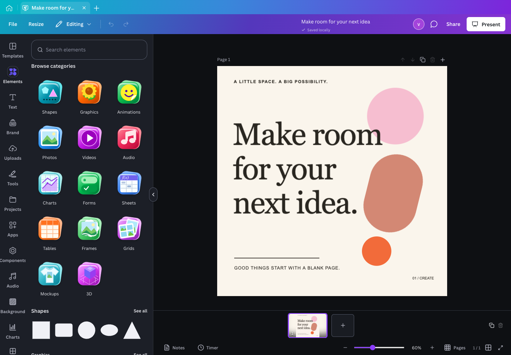
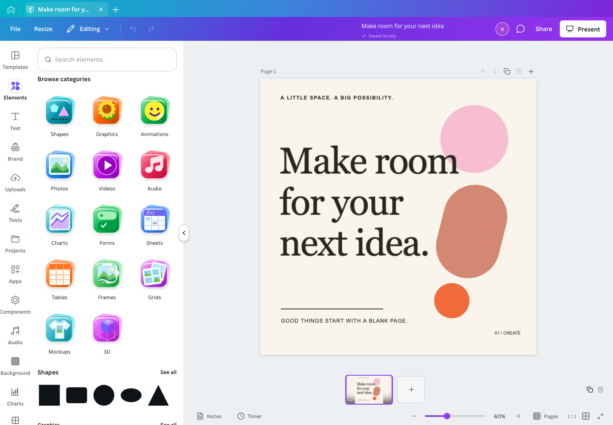
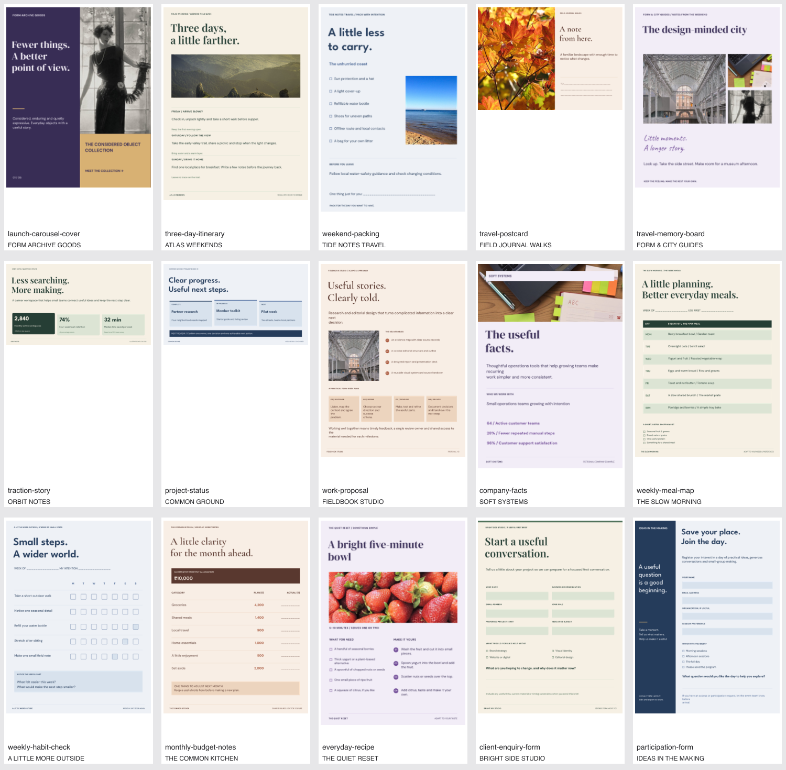

<p align="center">
  
</p>

<h1 align="center">Visro</h1>
<p align="center"><strong>A local creative studio for your Mac.</strong></p>
<p align="center">Design presentations, social posts, posters and more. Keep your projects local.<br />Bring your own Gemini key when you want AI.</p>

<p align="center">
  <a href="https://github.com/prakharsingh1/visro/releases/latest">Download for Mac</a> ·
  <a href="docs/GETTING_STARTED.md">Get started</a> ·
  <a href="docs/USER_GUIDE.md">User guide</a> ·
  <a href="CONTRIBUTING.md">Contribute</a>
</p>
<p align="center">
  <a href="https://github.com/prakharsingh1/visro/releases"></a>
  
  <a href="LICENSE"></a>
</p>



## Make something yours

Start with a template or a blank canvas. Drag in photos, edit real text and vectors, arrange layers, and export the result. Visro combines a familiar design workflow with local projects, offline photo background removal and optional AI tools.

| Inside Visro | What you can do |
| --- | --- |
| **650 original templates** | Create presentations, social posts, print layouts and more, with searchable previews and editable objects. |
| **144 shapes + 320 graphics** | Click or drag to add vectors, change colors, arrange layers and edit individual parts. |
| **46 font families + 48 font combinations** | Use bundled open fonts, brush and display styles, selected-text formatting and your own uploaded fonts. |
| **Frames, grids and 13 mockups** | Drop photos into editable image areas, adjust the crop and keep the surrounding artwork. |
| **Offline photo cutouts** | Remove backgrounds with a bundled local model; refine the result with erase and restore brushes. |
| **Multipage editing** | Scroll between pages, use real thumbnails, align objects, group layers and undo changes. |
| **More creative tools** | Work with documents, sheets, charts, tables, drawings, media timelines and manual captions. |
| **Optional Gemini** | Connect your own key for writing, editable design generation, images, speech and supported Veo video workflows. |

Dark, light and system appearance are included. Design assets already bundled or imported can be used offline. Gemini requests and optional Wikimedia Commons photo searches need an internet connection.

<details>
<summary><strong>See the light editor and original templates</strong></summary>



A selection of Visro's original editable layouts:



</details>

## Download and install

**Requires macOS 13 or later and an Apple silicon Mac (M1 or later).** Intel Mac, Windows and Linux installers are not provided in this release.

1. Open the [latest release](https://github.com/prakharsingh1/visro/releases/latest) and download the **arm64 DMG**.
2. Open the DMG and copy **Visro.app** into **Applications**.
3. Open Visro, choose a template or create a blank design. **A Gemini key is optional.**

This early release is ad-hoc signed and **not Apple-notarized**. If macOS blocks the first launch, review [Apple's instructions for opening a trusted app](https://support.apple.com/en-us/102445), then use the app-specific **Open Anyway** control in System Settings → Privacy & Security if you choose to continue. Checksums and a corresponding source ZIP accompany the release.

For installation help, your first design and backups, see [Getting started](docs/GETTING_STARTED.md).

## Your projects, your key

Projects autosave locally. Export a portable **`.visro`** file to back up a project or move it to another computer; regular image, document and media exports are also available. Clearing the app's local data can remove projects, so keep portable backups of work you want to retain.

To enable AI, open **File → Visro settings…**, paste your key from [Google AI Studio](https://aistudio.google.com/apikey), and choose **Connect Gemini**. The Mac app encrypts the key with Electron's macOS-backed safeStorage. Keys are excluded from project files and browser storage. Only content needed for an AI request is sent to Google's configured endpoints. Your Google project's model access, quota and billing apply; live generation still requires acceptance with your own key.

Optional **Elements → Photos** searches public-domain/CC0 images on Wikimedia Commons. Search queries and uncached downloads contact Commons; selected images are embedded locally with source and license details.

There is no Visro account or cloud project synchronization. The browser editor and desktop app use separate local storage; use `.visro` files to move projects between them.

## Run from source

Use **Node.js 22.12+**; Node **26.5** is the verified development toolchain. Native packaging requires macOS. The first full build downloads verified model and media assets.

```sh
git clone https://github.com/prakharsingh1/visro.git
cd visro
npm ci
npm run start
```

For the browser editor:

```sh
npm run dev
```

Open the local URL printed by Vite. The desktop app adds encrypted Gemini settings, native clipboard/printing and bundled media rendering. For desktop hot reload, testing and packaging, see [Contributing](CONTRIBUTING.md).

## Project status

Visro is an **early release**. It offers a broad local design workflow; complete Canva feature parity and universal freeze-free performance are not claimed. Advanced video keyframes, automatic transcription, video background removal, full document/spreadsheet compatibility and some effects remain incomplete. Cloud teams, paid stock, hosting and print fulfillment are outside its local scope.

The feature build passed **370 tests**, with one optional network test skipped. Packaged interaction checks included 50 real drags and save/reopen checks in isolated automation mode. That does not establish smoothness for every document or normal-window/macOS Spaces configuration. [Validation](docs/VALIDATION.md) records the measured results and limits.

- [Feature overview](docs/FEATURES.md) · [Workflow boundaries](docs/PARITY.md)
- [User guide and shortcuts](docs/USER_GUIDE.md) · [Getting started](docs/GETTING_STARTED.md)
- [Report a bug](https://github.com/prakharsingh1/visro/issues/new?template=bug_report.yml) · [Suggest a feature](https://github.com/prakharsingh1/visro/issues/new?template=feature_request.yml)
- [Contribute](CONTRIBUTING.md) · [Security reporting](SECURITY.md) · [Changelog](CHANGELOG.md)

## License and credits

Created by [Prakhar Singh](https://github.com/prakharsingh1). Visro is licensed under **[AGPL-3.0-only](LICENSE)**, including its IMG.LY background-removal integration. Bundled open fonts and public-domain/CC0 photographs retain their own notices; see [third-party credits](THIRD_PARTY_NOTICES.md) and [photo credits](public/template-photos/NOTICES.md).

Visro is an independent project and is not affiliated with Canva, Adobe or Google. The editable templates and graphics are original Visro assets. Proprietary Canva templates, stock and font binaries are not redistributed. When available, the interface can read Canva Sans from the user's existing local Canva installation; otherwise it uses a fallback. The separate MIT-licensed [REA fork](https://github.com/prakharsingh1/rea) is a research tool, not Visro's runtime.
